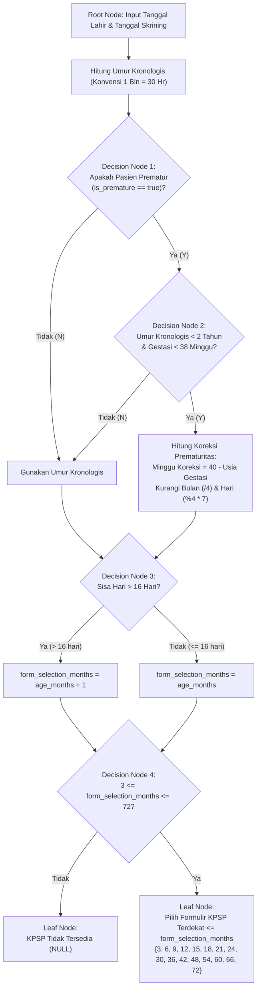
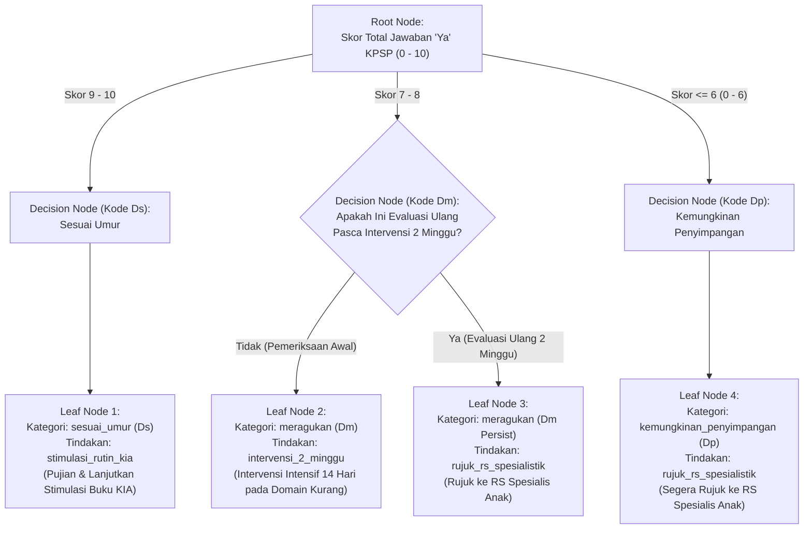
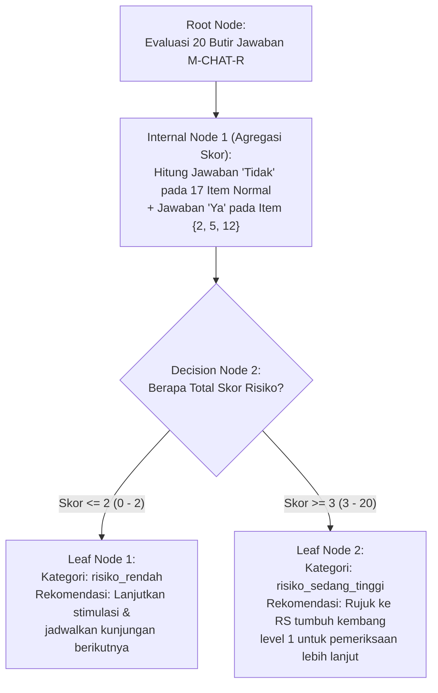
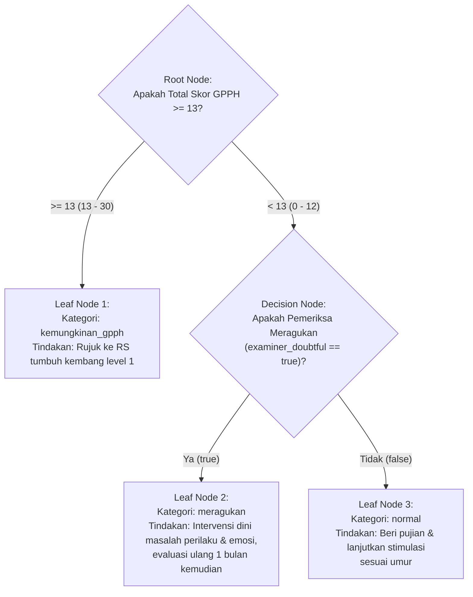
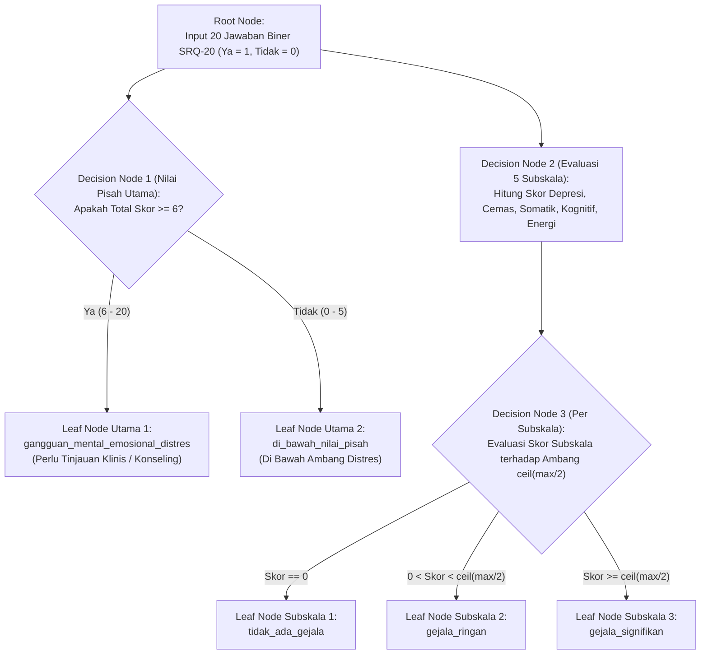

# Klasifikasi Knowledge Representation (KR) pada Sistem Pendukung Keputusan (CDSS) Skrining Tumbuh Kembang Anak

**Dokumen Spesifikasi Basis Pengetahuan & Model Representasi Keputusan Klinis**
**Sistem**: ClinicalInsight DSS — UPTD Balai Layanan Kesehatan Anak Berkebutuhan Khusus (BLK-ABK) Kota Balikpapan
**Referensi Metodologi Utama**:
1. Silva, B., Hak, F., Guimarães, T., Manuel, M., & Santos, M. F. (2023). *Rule-based System for Effective Clinical Decision Support*. Procedia Computer Science, 220, 880–885.
2. Freitas, A. A. (2014). *Comprehensible Classification Models: A Position Paper*. ACM SIGKDD Explorations Newsletter, 15(1), 1–10.
3. Witt, G. (2012). *Writing Effective Business Rules*. Morgan Kaufmann (Klasifikasi *Limited-Entry* vs *Extended-Entry Decision Table*).
4. Kementerian Kesehatan RI (2022). *Pedoman Pelaksanaan Stimulasi, Deteksi dan Intervensi Dini Tumbuh Kembang (SDIDTK) Anak di Tingkat Pelayanan Kesehatan Dasar* & Literatur Baku WHO (SRQ-20, SDQ).

---

## 1. Pemetaan Taksonomi Knowledge Representation (KR) terhadap Proyek

Berdasarkan kajian literatur Freitas (2014) dan Silva et al. (2023), klasifikasi *Knowledge Representation* (KR) pada sistem cerdas terbagi ke dalam **5 (lima) model utama**:
1. **Decision Tables** (*Limited-Entry* dan *Extended-Entry*)
2. **Classification Rules** (*IF–THEN Logical Production Rules*)
3. **Decision Trees** (*Root Node $\rightarrow$ Internal/Decision Node $\rightarrow$ Leaf Node*)
4. **Bayesian Network Classification** (*Probabilistic Directed Acyclic Graph / Naive Bayes*)
5. **Nearest Neighbors Algorithm ($k$-NN)** (*Instance-Based Distance Metric*)

Dalam arsitektur **Clinical Decision Support System (CDSS)**, kelima model tersebut terbagi ke dalam dua paradigma sistem:
- **Knowledge-Based CDSS (Rule-Based System)**: Menggunakan **Decision Tables**, **Classification Rules**, dan **Decision Trees**. Sistem ini mengeksekusi aturan klinis baku yang bersifat deterministik, terstandarisasi, dan bebas dari ambiguitas probabilistik.
- **Non-Knowledge-Based CDSS (Machine Learning / Data-Driven)**: Menggunakan **Bayesian Network** dan **Nearest Neighbors ($k$-NN)**. Sistem ini mengandalkan distribusi probabilitas historis atau kedekatan jarak antar-atribut pasien.

### 1.1. Matriks Kecocokan Model KR per Modul & Instrumen pada Proyek

Karena sistem **SPK Skrining Anak v3** mengimplementasikan pedoman klinis baku Kementerian Kesehatan RI dan WHO (`RuleBasedScoringService`), setiap instrumen dievaluasi kesesuaiannya secara ketat terhadap kelima tipe KR:

| No | Modul / Instrumen Skrining | Jumlah KR yang Cocok | Decision Tables | Classification Rules | Decision Trees | Bayesian Network | Nearest Neighbors ($k$-NN) | Alasan Teknis & Klinis Pemilihan Model KR |
| :-: | :--- | :-: | :-: | :-: | :-: | :-: | :-: | :--- |
| **0** | **Pra-Skrining: Kalkulasi Umur, Koreksi Prematuritas & Eligibilitas** (`KpspAgeCalculator`) | **3 Model** | ✅ **Cocok** | ✅ **Cocok** | ✅ **Sangat Cocok** | ❌ Tidak Digunakan | ❌ Tidak Digunakan | Memiliki percabangan hierarkis berjenjang (cek prematur $\rightarrow$ cek umur $< 2$ tahun $\rightarrow$ cek masa gestasi $< 38$ minggu $\rightarrow$ pembulatan $> 16$ hari $\rightarrow$ pemetaan umur ke 5 instrumen). |
| **1** | **KPSP** (*Kuesioner Pra Skrining Perkembangan*) | **3 Model** | ✅ **Sangat Cocok** | ✅ **Sangat Cocok** | ✅ **Sangat Cocok** | ❌ Tidak Digunakan | ❌ Tidak Digunakan | Menggabungkan aturan skoring domain (4 domain perkembangan) dengan **Alur Bagan SDIDTK 2 tahap** (interaksi antara skor `Ds/Dm/Dp` dan status kunjungan `Awal` vs `Evaluasi Ulang 2 Minggu`). |
| **2** | **M-CHAT-R** (*Modified Checklist for Autism in Toddlers, Revised*) | **3 Model** | ✅ **Sangat Cocok** | ✅ **Sangat Cocok** | ✅ **Cocok** *(Pohon Biner)* | ❌ Tidak Digunakan | ❌ Tidak Digunakan | Membutuhkan **Classification Rules** dan **Decision Table** untuk membedakan polaritas 17 item negatif (`Tidak = 1`) vs 3 item positif (`Ya = 1`), diikuti pohon keputusan *cutoff* biner ($\le 2$ vs $\ge 3$). |
| **3** | **GPPH / ACTRS** (*Abbreviated Conners Teacher Rating Scale*) | **3 Model** | ✅ **Sangat Cocok** | ✅ **Sangat Cocok** | ✅ **Sangat Cocok** | ❌ Tidak Digunakan | ❌ Tidak Digunakan | Sangat ideal direpresentasikan dengan **Decision Tree** dan **Decision Table** karena memiliki evaluasi sekuensial 2 variabel: `Skor Total >= 13` (prioritas 1) dan flag observasi `examiner_doubtful` (prioritas 2 jika skor $< 13$). |
| **4** | **SDQ (4–10 Tahun)** (*Strengths and Difficulties Questionnaire*) | **2 Model** | ✅ **Sangat Cocok** | ✅ **Sangat Cocok** | ⚠️ Kurang Efisien *(Paralel)* | ❌ Tidak Digunakan | ❌ Tidak Digunakan | Memiliki 6 dimensi penilaian yang dihitung secara **paralel/independen** (Emosional, Perilaku, Hiperaktivitas, Teman Sebaya, Total Kesulitan, Prososial) serta *reverse scoring* pada 5 item. Paling presisi direpresentasikan dengan **Extended-Entry Decision Table** & **Classification Rules**. |
| **5** | **SRQ-20** (*Self-Reporting Questionnaire 20*) | **3 Model** | ✅ **Sangat Cocok** | ✅ **Sangat Cocok** | ✅ **Cocok** | ❌ Tidak Digunakan | ❌ Tidak Digunakan | Menggunakan **Classification Rules** & **Decision Table** untuk nilai pisah utama ($\ge 6$) sekaligus memetakan 20 butir ke 5 subskala gejala klinis (Depresi, Cemas, Somatik, Kognitif, Energi) yang memiliki irisan item (*overlapping items* pada item 8, 12, 13). |

> **Catatan Mengenai Bayesian Network & Nearest Neighbors ($k$-NN)**:
> Kedua model tersebut tidak digunakan pada mesin skoring utama karena pedoman klinis SDIDTK Kemenkes RI menetapkan *cutoff* mutlak yang tidak boleh berubah berdasarkan fluktuasi data latih. Sebagai contoh, skor KPSP $= 8$ pada pemeriksaan awal **wajib secara hukum klinis** menghasilkan status `Meragukan (Dm)` dengan tindakan `Intervensi Dini 2 Minggu`, bukan estimasi probabilitas atau pencarian tetangga terdekat.

---

## 2. Modul Pra-Skrining: Koreksi Umur Prematur & Eligibilitas Instrumen

**Implementasi Kode**: `App\Services\KpspAgeCalculator` & `App\Http\Controllers\ScreeningSessionController`
**Model KR yang Cocok**: **3 Model** (*Classification Rules*, *Decision Table*, dan *Decision Tree*)

### 2.1. Classification Rules (IF–THEN Rules)

```text
// Aturan 1: Perhitungan Umur Kronologis (Konvensi Pinjam Bulan SDIDTK: 1 Bulan = 30 Hari, 1 Tahun = 12 Bulan)
RULE PRE-01 (Borrow Days):
  IF (screening_day - birth_day) < 0
  THEN days = (screening_day - birth_day) + 30
       AND months = (screening_month - birth_month) - 1

RULE PRE-02 (Borrow Months):
  IF months < 0
  THEN months = months + 12
       AND years = (screening_year - birth_year) - 1

// Aturan 2: Koreksi Prematuritas (Hanya berlaku untuk anak < 2 tahun dan usia kehamilan < 38 minggu)
RULE PRE-03 (Prematurity Correction):
  IF is_premature == TRUE AND chronological_years < 2 AND gestational_age_weeks < 38
  THEN correction_weeks = 40 - gestational_age_weeks
       AND correction_months = floor(correction_weeks / 4)
       AND correction_days = (correction_weeks MOD 4) * 7
       AND corrected_age = subtractAge(chronological_age, correction_months, correction_days)
  ELSE corrected_age = chronological_age

// Aturan 3: Pembulatan Hari untuk Pemilihan Formulir KPSP (SDIDTK: > 16 hari dibulatkan +1 bulan)
RULE PRE-04 (KPSP Form Rounding):
  IF corrected_age.days > 16
  THEN form_selection_months = (corrected_age.years * 12 + corrected_age.months) + 1
  ELSE form_selection_months = (corrected_age.years * 12 + corrected_age.months)

// Aturan 4: Pemilihan Kelompok Umur Formulir KPSP (Floor Matching)
RULE PRE-05 (KPSP Form Age Group Selection):
  IF form_selection_months >= 3 AND form_selection_months <= 72
  THEN form_age_months = MAX(f IN {3,6,9,12,15,18,21,24,30,36,42,48,54,60,66,72} WHERE f <= form_selection_months)
  ELSE form_age_months = NULL
```

### 2.2. Decision Table — Eligibilitas Instrumen Berdasarkan Umur

#### A. Extended-Entry Decision Table (Pemetaan Rentang Umur ke Paket Instrumen)

| Komponen | Variabel Kondisi / Tindakan | R1 | R2 | R3 | R4 | R5 | R6 |
| :--- | :--- | :---: | :---: | :---: | :---: | :---: | :---: |
| **Conditions** | **C1: Umur Terkoreksi (`age_months`)** | $< 3$ bln | $3 - 15$ bln | $16 - 30$ bln | $31 - 35$ bln | $36 - 47$ bln | $48 - 72$ bln |
| **Conditions** | **C2: `form_age_months` KPSP Tersedia** | `NULL` | `3..15` | `15..30` | `30` | `36..42` | `48..72` |
| **Actions** | **A1: KPSP (3–72 Bulan)** | Non-Eligibel | **Eligibel** | **Eligibel** | **Eligibel** | **Eligibel** | **Eligibel** |
| **Actions** | **A2: M-CHAT-R (16–30 Bulan)** | Non-Eligibel | Non-Eligibel | **Eligibel** | Non-Eligibel | Non-Eligibel | Non-Eligibel |
| **Actions** | **A3: GPPH / ACTRS (36–72 Bulan)** | Non-Eligibel | Non-Eligibel | Non-Eligibel | Non-Eligibel | **Eligibel** | **Eligibel** |
| **Actions** | **A4: SDQ (48–131 Bulan)** | Non-Eligibel | Non-Eligibel | Non-Eligibel | Non-Eligibel | Non-Eligibel | **Eligibel** |
| **Actions** | **A5: SRQ-20 (Orang Tua / Wali)** | **Eligibel** | **Eligibel** | **Eligibel** | **Eligibel** | **Eligibel** | **Eligibel** |

*(Catatan: Untuk rentang **R7: $73 - 131$ bulan**, instrumen yang eligibel adalah **SDQ** dan **SRQ-20**; untuk **R8: $\ge 132$ bulan**, hanya **SRQ-20**).*

### 2.3. Decision Tree — Alur Koreksi Umur & Penentuan Formulir KPSP



---

## 3. Instrumen 1: KPSP (Kuesioner Pra Skrining Perkembangan)

**Implementasi Kode**: `App\Services\Scoring\KpspScorer` & `App\Services\KpspCatalogService`
**Rentang Usia**: 3 – 72 Bulan (16 Kelompok Formulir Umur, masing-masing 10 Pertanyaan)
**Model KR yang Cocok**: **3 Model** (*Decision Tables*, *Classification Rules*, dan *Decision Trees*)

### 3.1. Classification Rules (IF–THEN Rules)

```text
// 1. Aturan Perhitungan Skor Total & Skor Per Domain Perkembangan
Let Answers = [a_1, a_2, ..., a_10] where a_i IN {TRUE (Ya), FALSE (Tidak)}
Let Domains = {gerak_kasar, gerak_halus, bicara_bahasa, sosialisasi_kemandirian}

RULE KPSP-01 (Total Score Calculation):
  total_score = COUNT(a_i WHERE a_i == TRUE)

RULE KPSP-02 (Domain Status Evaluation):
  FOR EACH domain d IN Domains:
    domain_passed(d) = COUNT(a_i IN domain(d) WHERE a_i == TRUE)
    domain_failed(d) = COUNT(a_i IN domain(d) WHERE a_i == FALSE)
    IF domain_failed(d) == 0 THEN domain_status(d) = "sesuai"
    ELSE domain_status(d) = "perlu_stimulasi"

// 2. Aturan Klasifikasi Kategori & Kode SDIDTK Kemenkes RI
RULE KPSP-03 (Sesuai Umur / Ds):
  IF total_score >= 9 AND total_score <= 10
  THEN category = "sesuai_umur"
       AND sdidtk_code = "Ds"

RULE KPSP-04 (Meragukan / Dm):
  IF total_score >= 7 AND total_score <= 8
  THEN category = "meragukan"
       AND sdidtk_code = "Dm"

RULE KPSP-05 (Kemungkinan Penyimpangan / Dp):
  IF total_score < 7
  THEN category = "kemungkinan_penyimpangan"
       AND sdidtk_code = "Dp"

// 3. Aturan Rantai Tindakan Klinis (Chained Clinical Action Rules — Alur Bagan SDIDTK)
RULE KPSP-06 (Action for Ds - Initial or Re-evaluation):
  IF sdidtk_code == "Ds"
  THEN clinical_action = "stimulasi_rutin_kia"
       AND recommendation = "Perkembangan anak Normal Sesuai Umur (Ds). Beri pujian pada orang tua. Lanjutkan stimulasi perkembangan di keluarga sesuai umur menggunakan buku KIA dan jadwalkan pemantauan berkala pada umur berikutnya."

RULE KPSP-07 (Action for Initial Dm - 2-Week Intensive Stimulation):
  IF sdidtk_code == "Dm" AND is_re_evaluation == FALSE
  THEN clinical_action = "intervensi_2_minggu"
       AND recommendation = "Perkembangan anak Meragukan (Dm). Lakukan intervensi dini perkembangan secara intensif selama 2 minggu terfokus pada domain yang belum tercapai, kemudian lakukan evaluasi ulang KPSP."

RULE KPSP-08 (Action for Persistent Dm on Re-evaluation - Golden Rule SDIDTK):
  IF sdidtk_code == "Dm" AND is_re_evaluation == TRUE
  THEN clinical_action = "rujuk_rs_spesialistik"
       AND recommendation = "Evaluasi ulang perkembangan setelah intervensi 2 minggu tetap Meragukan (Dm). Sesuai alur bagan SDIDTK Kemenkes RI, segera rujuk ke Rumah Sakit untuk penanganan spesialistik anak."

RULE KPSP-09 (Action for Dp - Direct Referral):
  IF sdidtk_code == "Dp"
  THEN clinical_action = "rujuk_rs_spesialistik"
       AND recommendation = "Ada kemungkinan penyimpangan perkembangan (Dp). Sesuai alur bagan SDIDTK Kemenkes RI, segera rujuk ke Rumah Sakit untuk penanganan spesialistik oleh dokter spesialis anak."
```

### 3.2. Decision Tables (Mengikuti Standar Witt, 2012 & Silva et al., 2023)

#### A. Limited-Entry Decision Table (Boolean `Y / N / -` & Action `X`)

| Bagian | Kondisi / Tindakan | R1 | R2 | R3 | R4 |
| :--- | :--- | :-: | :-: | :-: | :-: |
| **Conditions** | **C1: Skor Jawaban "Ya" $\ge 9$ ($9 - 10$)** | Y | N | N | N |
| **Conditions** | **C2: Skor Jawaban "Ya" $7 - 8$** | N | Y | Y | N |
| **Conditions** | **C3: Skor Jawaban "Ya" $\le 6$ ($0 - 6$)** | N | N | N | Y |
| **Conditions** | **C4: Sesi Evaluasi Ulang 2 Minggu (`is_re_evaluation == true`)** | - | N | Y | - |
| **Actions** | **A1: Kategori = `sesuai_umur` (Kode `Ds`)** | **X** | | | |
| **Actions** | **A2: Kategori = `meragukan` (Kode `Dm`)** | | **X** | **X** | |
| **Actions** | **A3: Kategori = `kemungkinan_penyimpangan` (Kode `Dp`)** | | | | **X** |
| **Actions** | **A4: Tindakan = `stimulasi_rutin_kia` (Lanjutkan Buku KIA)** | **X** | | | |
| **Actions** | **A5: Tindakan = `intervensi_2_minggu` (Stimulasi Intensif 14 Hari)** | | **X** | | |
| **Actions** | **A6: Tindakan = `rujuk_rs_spesialistik` (Rujuk RS Tumbuh Kembang)** | | | **X** | **X** |

*(Keterangan: Simbol `-` berarti kondisi tersebut tidak memengaruhi hasil / *not applicable*, sesuai notasi Graham Witt pada Gambar 2 paper referensi).*

#### B. Extended-Entry Decision Table (Nilai Atribut Eksplisit)

| Bagian | Variabel | R1 | R2 | R3 | R4 |
| :--- | :--- | :---: | :---: | :---: | :---: |
| **Conditions** | **Skor Jawaban "Ya" (`score`)** | $9 - 10$ | $7 - 8$ | $7 - 8$ | $0 - 6$ |
| **Conditions** | **Jenis Kunjungan (`evaluation_type`)** | `-` (Semua) | `initial` (Awal) | `re_evaluation` (Ulang) | `-` (Semua) |
| **Actions** | **Kategori Klinis (`category`)** | `sesuai_umur` | `meragukan` | `meragukan` | `kemungkinan_penyimpangan` |
| **Actions** | **Kode SDIDTK (`sdidtk_code`)** | `Ds` | `Dm` | `Dm` | `Dp` |
| **Actions** | **Tindakan Klinis (`clinical_action`)** | `stimulasi_rutin_kia` | `intervensi_2_minggu` | `rujuk_rs_spesialistik` | `rujuk_rs_spesialistik` |

### 3.3. Decision Tree — Pohon Keputusan Klinis KPSP & Alur SDIDTK



---

## 4. Instrumen 2: M-CHAT-R (Modified Checklist for Autism in Toddlers, Revised)

**Implementasi Kode**: `App\Services\Scoring\MchatScorer`
**Rentang Usia**: 16 – 30 Bulan (20 Pertanyaan Ya/Tidak)
**Model KR yang Cocok**: **3 Model** (*Classification Rules*, *Decision Tables*, dan *Decision Tree*)

### 4.1. Classification Rules (IF–THEN Rules)

Pada M-CHAT-R, pengetahuan klinis terpenting terletak pada **aturan polaritas arah risiko item** sebelum skor dijumlahkan:

```text
// 1. Himpunan Nomor Butir berdasarkan Arah Risiko Autisme
Let NEGATIVE_SCORED_ITEMS = {1, 3, 4, 6, 7, 8, 9, 10, 11, 13, 14, 15, 16, 17, 18, 19, 20} (17 butir)
Let POSITIVE_SCORED_ITEMS = {2, 5, 12} (3 butir: curiga tuli, gerakan jari tidak biasa, sensitif bising)

// 2. Aturan Transformasi Jawaban menjadi Poin Risiko (Item-Level Rules)
RULE MCHAT-01 (Negative-Scored Items Risk Rule):
  FOR EACH item i IN NEGATIVE_SCORED_ITEMS:
    IF answer[i] == FALSE ("Tidak")
    THEN item_point[i] = 1
    ELSE item_point[i] = 0

RULE MCHAT-02 (Positive-Scored Items Risk Rule):
  FOR EACH item i IN POSITIVE_SCORED_ITEMS:
    IF answer[i] == TRUE ("Ya")
    THEN item_point[i] = 1
    ELSE item_point[i] = 0

RULE MCHAT-03 (Total Risk Score):
  total_score = SUM(item_point[1..20])

// 3. Aturan Klasifikasi Risiko & Rekomendasi Rujukan
RULE MCHAT-04 (Low Risk / Risiko Rendah):
  IF total_score <= 2
  THEN category = "risiko_rendah"
       AND recommendation = "Lanjutkan stimulasi dan jadwalkan kunjungan berikutnya."

RULE MCHAT-05 (Medium-High Risk / Risiko Sedang-Tinggi):
  IF total_score >= 3
  THEN category = "risiko_sedang_tinggi"
       AND recommendation = "Rujuk ke RS tumbuh kembang level 1 untuk pemeriksaan lebih lanjut."
```

### 4.2. Decision Tables

#### A. Decision Table — Aturan Skoring Butir Pertanyaan (Item Polarity Table)

| Bagian | Kondisi / Tindakan | R1 | R2 | R3 | R4 |
| :--- | :--- | :-: | :-: | :-: | :-: |
| **Conditions** | **C1: Nomor Item $\in \{1, 3, 4, 6, 7, 8, 9, 10, 11, 13, 14, 15, 16, 17, 18, 19, 20\}$** | Y | Y | N | N |
| **Conditions** | **C2: Nomor Item $\in \{2, 5, 12\}$** | N | N | Y | Y |
| **Conditions** | **C3: Jawaban Orang Tua = `"Ya"` (`true`)** | Y | N | Y | N |
| **Actions** | **A1: Tambah Skor Risiko $+1$ (`point = 1`)** | | **X** | **X** | |
| **Actions** | **A2: Skor Risiko $+0$ (`point = 0`)** | **X** | | | **X** |

#### B. Decision Table — Klasifikasi Akhir M-CHAT-R (Limited-Entry & Extended-Entry)

| Bagian | Kondisi / Tindakan (Limited-Entry) | R1 | R2 | Variabel (Extended-Entry) | R1 | R2 |
| :--- | :--- | :-: | :-: | :--- | :-: | :-: |
| **Conditions** | **C1: Total Skor Risiko $\le 2$** | Y | N | **Total Skor (`total_score`)** | $0 - 2$ | $3 - 20$ |
| **Conditions** | **C2: Total Skor Risiko $\ge 3$** | N | Y | **Kelayakan Umur (`age_months`)** | $16 - 30$ bln | $16 - 30$ bln |
| **Actions** | **A1: `risiko_rendah` (Stimulasi Rutin)** | **X** | | **Kategori (`category`)** | `risiko_rendah` | `risiko_sedang_tinggi` |
| **Actions** | **A2: `risiko_sedang_tinggi` (Rujuk RS Level 1)** | | **X** | **Tindakan (`recommendation`)** | Lanjutkan stimulasi | Rujuk RS tumbuh kembang level 1 |

### 4.3. Decision Tree — Pohon Keputusan M-CHAT-R



---

## 5. Instrumen 3: GPPH / ACTRS (Gangguan Pemusatan Perhatian dan Hiperaktivitas)

**Implementasi Kode**: `App\Services\Scoring\GpphScorer`
**Rentang Usia**: 36 – 72 Bulan / 3 – 6 Tahun (10 Pertanyaan Skala Ordinal $0 - 3$ + Observasi Pemeriksa)
**Model KR yang Cocok**: **3 Model** (*Decision Tables*, *Classification Rules*, dan *Decision Trees*)

> **Keunikan Pengetahuan Klinis GPPH**:
> Instrumen GPPH menggabungkan **skor kuantitatif** ($\sum_{i=1}^{10} a_i \in [0, 30]$) dengan **variabel observasi kualitatif pemeriksa** (`examiner_doubtful` boolean). Meskipun skor anak $< 13$, apabila pemeriksa merasa ragu berdasarkan observasi klinis selama sesi berlangsung, status anak tidak diklasifikasikan `normal`, melainkan naik menjadi `meragukan` dengan protokol intervensi 1 bulan.

### 5.1. Classification Rules (IF–THEN Rules)

```text
// 1. Aturan Bobot Skala Ordinal GPPH (ACTRS)
// 0 = Tidak pernah, 1 = Kadang-kadang, 2 = Sering, 3 = Selalu / Sangat sering
Let Answers = [a_1, a_2, ..., a_10] where a_i IN {0, 1, 2, 3}
Let examiner_doubtful IN {TRUE, FALSE}

RULE GPPH-01 (Total Score Calculation):
  total_score = SUM(a_1 .. a_10)

// 2. Aturan Klasifikasi Berjenjang (Ordered Priority Rules)
RULE GPPH-02 (Kemungkinan GPPH - Cutoff Utama >= 13):
  IF total_score >= 13
  THEN category = "kemungkinan_gpph"
       AND recommendation = "Rujuk ke RS tumbuh kembang level 1."

RULE GPPH-03 (Meragukan - Skor < 13 namun Pemeriksa Meragukan):
  IF total_score < 13 AND examiner_doubtful == TRUE
  THEN category = "meragukan"
       AND recommendation = "Lakukan intervensi dini masalah perilaku dan emosi. Evaluasi ulang 1 bulan kemudian dengan buku SDIDTK."

RULE GPPH-04 (Normal - Skor < 13 dan Pemeriksa Tidak Meragukan):
  IF total_score < 13 AND examiner_doubtful == FALSE
  THEN category = "normal"
       AND recommendation = "Berikan pujian kepada orang tua atau pengasuh dan anak. Lanjutkan stimulasi sesuai umur. Jadwalkan kunjungan berikutnya."
```

### 5.2. Decision Tables

#### A. Limited-Entry Decision Table

| Bagian | Kondisi / Tindakan | R1 | R2 | R3 |
| :--- | :--- | :-: | :-: | :-: |
| **Conditions** | **C1: Total Skor GPPH $\ge 13$ ($13 - 30$)** | Y | N | N |
| **Conditions** | **C2: Total Skor GPPH $< 13$ ($0 - 12$)** | N | Y | Y |
| **Conditions** | **C3: Pemeriksa Meragukan (`examiner_doubtful == true`)** | - | Y | N |
| **Actions** | **A1: Kategori = `kemungkinan_gpph` (Rujuk RS Tumbuh Kembang Level 1)** | **X** | | |
| **Actions** | **A2: Kategori = `meragukan` (Intervensi Dini & Evaluasi Ulang 1 Bulan)** | | **X** | |
| **Actions** | **A3: Kategori = `normal` (Beri Pujian & Lanjutkan Stimulasi Sesuai Umur)** | | | **X** |

#### B. Extended-Entry Decision Table

| Bagian | Variabel | R1 | R2 | R3 |
| :--- | :--- | :---: | :---: | :---: |
| **Conditions** | **Total Skor (`total_score`)** | $\ge 13$ ($13 - 30$) | $< 13$ ($0 - 12$) | $< 13$ ($0 - 12$) |
| **Conditions** | **Pemeriksa Meragukan (`examiner_doubtful`)** | `-` (Tidak berpengaruh) | `true` (Ya) | `false` (Tidak) |
| **Actions** | **Kategori (`category`)** | `kemungkinan_gpph` | `meragukan` | `normal` |
| **Actions** | **Tindak Lanjut Klinis** | Rujuk RS tumbuh kembang level 1 | Intervensi dini perilaku & evaluasi 1 bln | Pujian & stimulasi rutin |

### 5.3. Decision Tree — Pohon Keputusan GPPH (Mirip Struktur Gambar 3b pada Paper Silva et al., 2023)

Struktur keputusan GPPH sangat identik dengan contoh pohon keputusan bertingkat pada Gambar 3b dalam paper Silva et al. (2023):



---

## 6. Instrumen 4: SDQ (Strengths and Difficulties Questionnaire — Usia 4–10 Tahun)

**Implementasi Kode**: `App\Services\Scoring\SdqScorer`
**Rentang Usia**: 48 – 131 Bulan / 4 Tahun sampai sebelum 11 Tahun (25 Pertanyaan Skala $0 - 2$)
**Model KR yang Cocok**: **2 Model Utama** (*Classification Rules* dan *Decision Tables*)

> **Mengapa SDQ Paling Tepat Menggunakan 2 Model KR (Classification Rules & Decision Tables)**:
> Berbeda dengan KPSP atau GPPH yang memiliki percabangan kondisi berurutan (*sequential branching*), SDQ mengevaluasi **6 dimensi psikometrik secara paralel** (5 subskala + 1 skor komposit *Total Difficulties*). Selain itu, 5 dari 25 item menggunakan *reverse scoring*, dan subskala **Prososial** memiliki arah interpretasi terbalik (semakin tinggi skor semakin normal, sedangkan 4 subskala kesulitan semakin tinggi skor semakin abnormal). Struktur matriks paralel ini paling presisi dan ringkas apabila direpresentasikan melalui **Classification Rules** dan **Extended-Entry Decision Table**.

### 6.1. Classification Rules (IF–THEN Rules)

```text
// 1. Pemetaan Kelompok Item Subskala & Item Reverse Scoring
Let REVERSE_ITEMS       = {7, 11, 14, 21, 25}
Let NORMAL_ITEMS        = {1..25} \ REVERSE_ITEMS
Let EMOTIONAL_ITEMS     = {3, 8, 13, 16, 24}
Let CONDUCT_ITEMS       = {5, 7, 12, 18, 22}
Let HYPERACTIVITY_ITEMS = {2, 10, 15, 21, 25}
Let PEER_ITEMS          = {6, 11, 14, 19, 23}
Let PROSOCIAL_ITEMS     = {1, 4, 9, 17, 20}

// 2. Aturan Transformasi Skor Butir (0 = Tidak Benar, 1 = Agak Benar, 2 = Selalu Benar)
RULE SDQ-01 (Normal vs Reverse Item Scoring):
  FOR i = 1 TO 25:
    IF i IN REVERSE_ITEMS
    THEN item_score[i] = 2 - answer[i]
    ELSE item_score[i] = answer[i]

// 3. Aturan Agregasi Subskala & Total Kesulitan (Total Difficulties)
RULE SDQ-02 (Subscale & Composite Aggregation):
  emotional          = SUM(item_score[i] WHERE i IN EMOTIONAL_ITEMS)       // Rentang 0..10
  conduct            = SUM(item_score[i] WHERE i IN CONDUCT_ITEMS)         // Rentang 0..10
  hyperactivity      = SUM(item_score[i] WHERE i IN HYPERACTIVITY_ITEMS)   // Rentang 0..10
  peer               = SUM(item_score[i] WHERE i IN PEER_ITEMS)            // Rentang 0..10
  prosocial          = SUM(item_score[i] WHERE i IN PROSOCIAL_ITEMS)       // Rentang 0..10 (Kekuatan)
  total_difficulties = emotional + conduct + hyperactivity + peer          // Rentang 0..40 (Tanpa Prososial)

// 4. Aturan Klasifikasi Ambang Batas (Cutoffs) per Dimensi
RULE SDQ-03 (Gejala Emosional / Emotional Symptoms):
  IF emotional <= 3      THEN cat_emotional = "normal"
  ELSE IF emotional == 4 THEN cat_emotional = "ambang_borderline"
  ELSE                        cat_emotional = "abnormal"                   // 5..10

RULE SDQ-04 (Masalah Perilaku / Conduct Problems):
  IF conduct <= 2        THEN cat_conduct = "normal"
  ELSE IF conduct == 3   THEN cat_conduct = "ambang_borderline"
  ELSE                        cat_conduct = "abnormal"                     // 4..10

RULE SDQ-05 (Hiperaktivitas / Hyperactivity-Inattention):
  IF hyperactivity <= 5      THEN cat_hyperactivity = "normal"
  ELSE IF hyperactivity == 6 THEN cat_hyperactivity = "ambang_borderline"
  ELSE                            cat_hyperactivity = "abnormal"           // 7..10

RULE SDQ-06 (Masalah Teman Sebaya / Peer Problems):
  IF peer <= 2           THEN cat_peer = "normal"
  ELSE IF peer == 3      THEN cat_peer = "ambang_borderline"
  ELSE                        cat_peer = "abnormal"                        // 4..10

RULE SDQ-07 (Total Kesulitan / Total Difficulties Score):
  IF total_difficulties <= 13      THEN cat_total = "normal"               // 0..13
  ELSE IF total_difficulties <= 15 THEN cat_total = "ambang_borderline"    // 14..15
  ELSE                                  cat_total = "abnormal"             // 16..40

RULE SDQ-08 (Perilaku Prososial / Prosocial Behavior - Inverse Direction):
  IF prosocial >= 6      THEN cat_prosocial = "normal"                     // 6..10
  ELSE IF prosocial == 5 THEN cat_prosocial = "ambang_borderline"          // 5
  ELSE                        cat_prosocial = "abnormal"                   // 0..4
```

### 6.2. Decision Tables

#### A. Decision Table — Transformasi Skor Butir SDQ (Normal vs Reverse Scoring)

| Bagian | Variabel | R1 | R2 | R3 | R4 | R5 | R6 |
| :--- | :--- | :-: | :-: | :-: | :-: | :-: | :-: |
| **Conditions** | **C1: Jenis Butir Pertanyaan** | Normal | Normal | Normal | Reverse $\{7,11,14,21,25\}$ | Reverse $\{7,11,14,21,25\}$ | Reverse $\{7,11,14,21,25\}$ |
| **Conditions** | **C2: Input Jawaban (`answer`)** | `0` (Tidak Benar) | `1` (Agak Benar) | `2` (Selalu Benar) | `0` (Tidak Benar) | `1` (Agak Benar) | `2` (Selalu Benar) |
| **Actions** | **A1: Skor Item (`item_score`)** | **0** | **1** | **2** | **2** | **1** | **0** |

#### B. Extended-Entry Decision Table — Klasifikasi 6 Dimensi SDQ (Usia 4–10 Tahun)

| Bagian | Variabel | R1 | R2 | R3 | R4 | R5 | R6 |
| :--- | :--- | :---: | :---: | :---: | :---: | :---: | :---: |
| **Conditions** | **Dimensi Subskala** | `emotional` | `conduct` | `hyperactivity` | `peer` | `total_difficulties` | `prosocial` *(Kekuatan)* |
| **Conditions** | **Butir Pertanyaan** | $\{3,8,13,16,24\}$ | $\{5,7^*,12,18,22\}$ | $\{2,10,15,21^*,25^*\}$ | $\{6,11^*,14^*,19,23\}$ | $\sum 4\text{ Kesulitan}$ | $\{1,4,9,17,20\}$ |
| **Conditions** | **Rentang Skor `normal`** | $0 - 3$ | $0 - 2$ | $0 - 5$ | $0 - 2$ | $0 - 13$ | $6 - 10$ |
| **Conditions** | **Rentang Skor `ambang_borderline`** | $4$ | $3$ | $6$ | $3$ | $14 - 15$ | $5$ |
| **Conditions** | **Rentang Skor `abnormal`** | $5 - 10$ | $4 - 10$ | $7 - 10$ | $4 - 10$ | $16 - 40$ | $0 - 4$ |
| **Actions** | **Output Klasifikasi** | `normal` / `ambang_borderline` / `abnormal` | `normal` / `ambang_borderline` / `abnormal` | `normal` / `ambang_borderline` / `abnormal` | `normal` / `ambang_borderline` / `abnormal` | `normal` / `ambang_borderline` / `abnormal` | `normal` / `ambang_borderline` / `abnormal` |

*(Keterangan: Tanda $^*$ menunjukkan item dengan *reverse scoring* `2 - answer`).*

---

## 7. Instrumen 5: SRQ-20 (Self-Reporting Questionnaire 20)

**Implementasi Kode**: `App\Services\Scoring\SrqScorer`
**Target Responden**: Orang Tua / Wali Pendamping Pasien (20 Pertanyaan Biner Ya/Tidak)
**Model KR yang Cocok**: **3 Model** (*Classification Rules*, *Decision Tables*, dan *Decision Tree*)

> **Karakteristik Pengetahuan Klinis SRQ-20**:
> Selain menentukan status skrining utama berdasarkan nilai pisah (*cutoff* $\ge 6$), sistem kita mengimplementasikan pemetaan 5 subskala gejala klinis berdasarkan pedoman Riskesdas / Litbang Depkes RI. Terdapat pengetahuan domain yang unik di mana butir nomor **8, 12, dan 13** beririsan (*multi-label mapping*) antara subskala **Gejala Kognitif** dan **Gejala Penurunan Energi**.

### 7.1. Classification Rules (IF–THEN Rules)

```text
// 1. Pemetaan Jawaban Biner (Ya = 1, Tidak = 0)
Let Answers = [a_1, a_2, ..., a_20] where a_i IN {TRUE, FALSE}
FOR i = 1 TO 20:
  item_score[i] = (a_i == TRUE) ? 1 : 0

// 2. Pemetaan Himpunan Butir Subskala Gejala Klinis (Riskesdas / Litbang Depkes RI / WHO)
Let DEPRESSION_ITEMS = {6, 9, 10, 14, 15, 16, 17}       (Maks = 7, Ambang Signifikan = ceil(7/2) = 4)
Let ANXIETY_ITEMS    = {3, 4, 5}                        (Maks = 3, Ambang Signifikan = ceil(3/2) = 2)
Let SOMATIC_ITEMS    = {1, 2, 7, 19}                    (Maks = 4, Ambang Signifikan = ceil(4/2) = 2)
Let COGNITIVE_ITEMS  = {8, 12, 13}                      (Maks = 3, Ambang Signifikan = ceil(3/2) = 2)
Let ENERGY_ITEMS     = {8, 11, 12, 13, 18, 20}          (Maks = 6, Ambang Signifikan = ceil(6/2) = 3)

// 3. Aturan Klasifikasi Nilai Pisah Utama (Overall Screening Cutoff)
RULE SRQ-01 (Total Score):
  total_score = SUM(item_score[1..20])

RULE SRQ-02 (Positive Distress Cutoff >= 6):
  IF total_score >= 6
  THEN overall_category = "gangguan_mental_emosional_distres"
  ELSE overall_category = "di_bawah_nilai_pisah"

// 4. Aturan Klasifikasi Tingkat Keparahan Tiap Subskala Gejala
RULE SRQ-03 (Subscale Severity Rule):
  FOR EACH subscale S IN {depression, anxiety, somatic, cognitive, energy}:
    IF score(S) == 0
    THEN category(S) = "tidak_ada_gejala"
    ELSE IF score(S) >= CEIL(max_items(S) / 2)
    THEN category(S) = "gejala_signifikan"
    ELSE category(S) = "gejala_ringan"
```

### 7.2. Decision Tables

#### A. Limited-Entry Decision Table — Klasifikasi Utama SRQ-20

| Bagian | Kondisi / Tindakan | R1 | R2 |
| :--- | :--- | :-: | :-: |
| **Conditions** | **C1: Total Skor Jawaban "Ya" $\ge 6$ ($6 - 20$)** | Y | N |
| **Conditions** | **C2: Total Skor Jawaban "Ya" $\le 5$ ($0 - 5$)** | N | Y |
| **Actions** | **A1: Kategori = `gangguan_mental_emosional_distres` (Indikasi Distres / GME)** | **X** | |
| **Actions** | **A2: Kategori = `di_bawah_nilai_pisah` (Normal / Di Bawah Cutoff)** | | **X** |

#### B. Extended-Entry Decision Table — Klasifikasi 5 Subskala Gejala Klinis SRQ-20

| Bagian | Variabel | R1 (Depresi) | R2 (Cemas) | R3 (Somatik) | R4 (Kognitif) | R5 (Penurunan Energi) |
| :--- | :--- | :---: | :---: | :---: | :---: | :---: |
| **Conditions** | **Nomor Butir Pertanyaan** | $\{6,9,10,14,15,16,17\}$ | $\{3,4,5\}$ | $\{1,2,7,19\}$ | $\{8,12,13\}$ | $\{8,11,12,13,18,20\}$ |
| **Conditions** | **Jumlah Butir Maksimum (`max`)** | $7$ | $3$ | $4$ | $3$ | $6$ |
| **Conditions** | **Skor `tidak_ada_gejala`** | $0$ | $0$ | $0$ | $0$ | $0$ |
| **Conditions** | **Skor `gejala_ringan`** | $1 - 3$ | $1$ | $1$ | $1$ | $1 - 2$ |
| **Conditions** | **Skor `gejala_signifikan` ($\ge \lceil \text{max}/2 \rceil$)** | $4 - 7$ | $2 - 3$ | $2 - 4$ | $2 - 3$ | $3 - 6$ |
| **Actions** | **Kategori Subskala** | `tidak_ada_gejala` / `gejala_ringan` / `gejala_signifikan` | `tidak_ada_gejala` / `gejala_ringan` / `gejala_signifikan` | `tidak_ada_gejala` / `gejala_ringan` / `gejala_signifikan` | `tidak_ada_gejala` / `gejala_ringan` / `gejala_signifikan` | `tidak_ada_gejala` / `gejala_ringan` / `gejala_signifikan` |

### 7.3. Decision Tree — Pohon Keputusan SRQ-20 & Subskala Gejala



---

## 8. Ringkasan Eksekutif untuk Dokumentasi / Laporan Penelitian

1. **Paradigma CDSS**: Sistem Pendukung Keputusan Skrining Tumbuh Kembang Anak ini merupakan **Knowledge-Based CDSS (Rule-Based Expert System)** yang menerjemahkan pedoman klinis Kemenkes RI (SDIDTK) dan WHO ke dalam mesin inferensi deterministik (`App\Services\Scoring\RuleBasedScoringService`).
2. **Pemilihan Model Knowledge Representation (KR)**:
   - **Modul Pra-Skrining (`KpspAgeCalculator`)**: Direpresentasikan menggunakan **3 model KR** (*Classification Rules*, *Decision Table*, dan *Decision Tree*).
   - **KPSP (`KpspScorer`)**: Direpresentasikan menggunakan **3 model KR** (*Classification Rules*, *Decision Table*, dan *Decision Tree*).
   - **M-CHAT-R (`MchatScorer`)**: Direpresentasikan menggunakan **3 model KR** (*Classification Rules*, *Decision Table*, dan *Decision Tree*).
   - **GPPH / ACTRS (`GpphScorer`)**: Direpresentasikan menggunakan **3 model KR** (*Classification Rules*, *Decision Table*, dan *Decision Tree*).
   - **SDQ (`SdqScorer`)**: Direpresentasikan menggunakan **2 model KR** (*Classification Rules* dan *Extended-Entry Decision Table*) karena ke-6 dimensinya dievaluasi secara paralel.
   - **SRQ-20 (`SrqScorer`)**: Direpresentasikan menggunakan **3 model KR** (*Classification Rules*, *Decision Table*, dan *Decision Tree*).
3. **Kesesuaian dengan Literatur Silva et al. (2023)**: Seluruh aturan klinis telah distrukturkan ke dalam format **Limited-Entry Decision Table**, **Extended-Entry Decision Table**, **IF–THEN Classification Rules**, serta **Decision Trees** (*Root Node*, *Decision Node*, *Leaf Node*) sehingga transparan, mudah diaudit oleh tenaga medis (Dokter Spesialis Anak & Perawat), serta bebas dari efek *black-box*.
